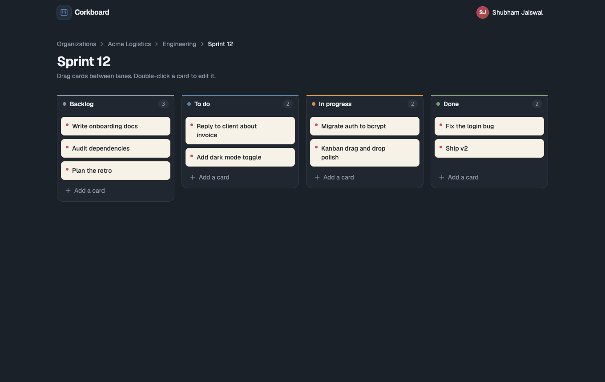
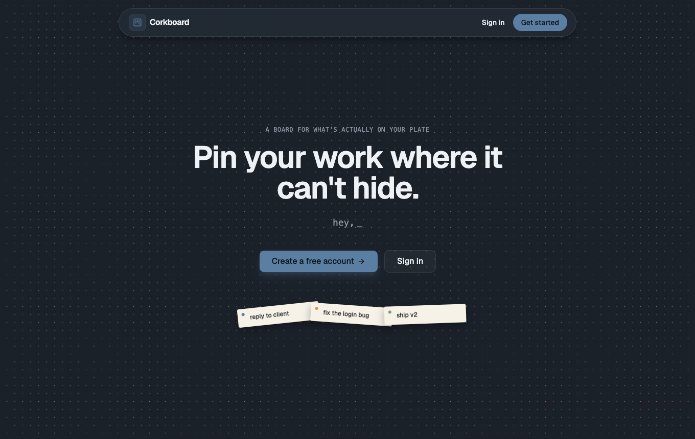
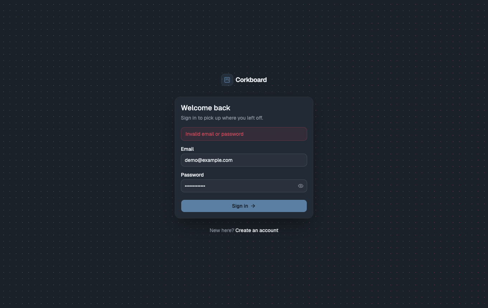
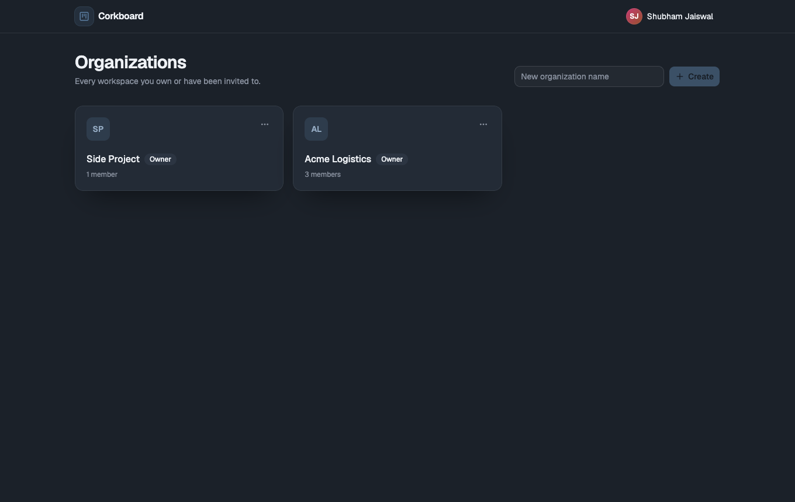
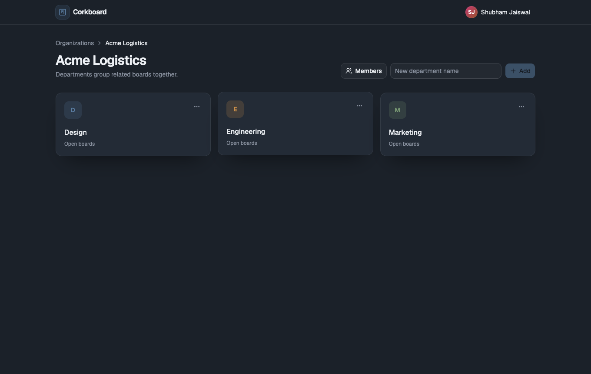
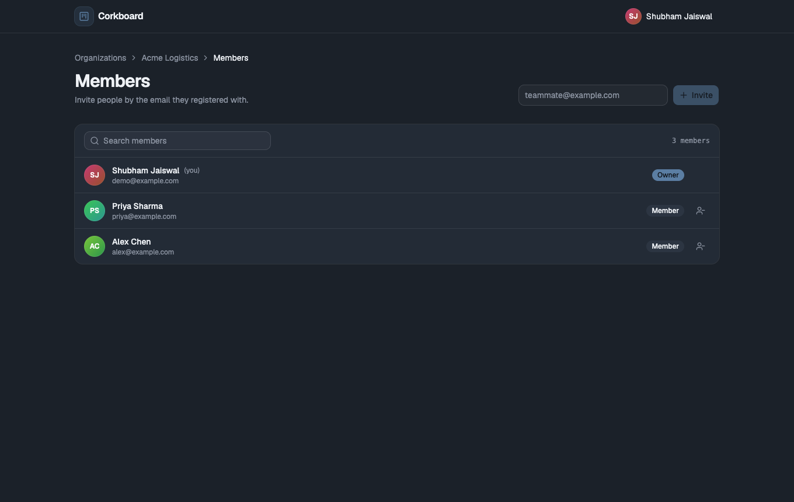

<div align="center">

# Corkboard

**A multi-tenant, Trello-style kanban app — pin your work where it can't hide.**

Organizations → Departments → Boards → Cards, with role-based access, drag-and-drop lanes and a dark corkboard UI.




</div>

---

## Table of contents

- [Features](#features)
- [Screenshots](#screenshots)
- [Tech stack](#tech-stack)
- [Architecture](#architecture)
  - [Data model](#data-model)
  - [Authentication](#authentication)
  - [Authorization and tenant isolation](#authorization-and-tenant-isolation)
  - [Error handling](#error-handling)
- [Project structure](#project-structure)
- [Getting started](#getting-started)
- [Environment variables](#environment-variables)
- [Scripts](#scripts)
- [API reference](#api-reference)
- [Frontend](#frontend)
- [Upgrading from an earlier version](#upgrading-from-an-earlier-version)
- [Roadmap](#roadmap)

---

## Features

**Workspaces and teams**
- Create **organizations**; the creator becomes the **owner**.
- Owners **invite members** by the email they registered with, and can remove them.
- Members can **leave** an organization; the owner can't be removed (delete the organization instead).
- Split each organization into **departments**, and each department into **boards**.

**Kanban boards**
- Four lanes: **Backlog → To do → In progress → Done**.
- **Drag and drop** cards between lanes (powered by `@dnd-kit/react`).
- **Add a card** directly into any lane.
- **Double-click to edit** a card inline (Enter saves, Shift+Enter adds a new line, Esc cancels).
- **Delete with undo** — a toast lets you restore the card instantly.
- **Optimistic updates** — the UI changes immediately and rolls back only the failed change if the server rejects it.

**Security**
- Passwords hashed with **bcrypt**; plaintext passwords from older versions are upgraded on the user's next login.
- **JWT Bearer tokens** that carry only the user ID (7-day expiry).
- Every org, department, board and card route checks **organization membership**, and child resources are always looked up **inside their parent**, so IDs from another organization can't be used to read or modify its data.
- Deleting an organization, department or board **cascades** to everything beneath it.
- CORS restricted to configured origins; internal error details are never sent to clients.

**UX**
- Built with **shadcn/ui** components and **React Bits** effects (spotlight cards, dot-field background, typing text).
- Breadcrumb navigation, skeleton loaders, empty states, confirmation dialogs and toasts throughout.
- Expired sessions redirect to login with a notice and return you to the page you were on.
- Routes are lazy-loaded to keep the initial bundle small.

---

## Screenshots

| Landing page | Sign in |
| --- | --- |
|  |  |

| Organizations | Departments |
| --- | --- |
|  |  |

| Members | Board |
| --- | --- |
|  |  |

---

## Tech stack

| Layer | Technologies |
| --- | --- |
| **Backend** | Node.js, Express 5, MongoDB, Mongoose 9, JSON Web Tokens, bcryptjs, cors, dotenv |
| **Frontend** | React 19, TypeScript, Vite 8, React Router 7, Axios |
| **UI** | Tailwind CSS 4, shadcn/ui (Base UI primitives), React Bits, lucide-react, sonner, tw-animate-css, GSAP |
| **Drag and drop** | `@dnd-kit/react` |
| **Tooling** | ESLint (typescript-eslint, react-hooks, react-refresh) |

---

## Architecture

```
┌──────────────────────────┐   HTTPS + Bearer token   ┌──────────────────────────────┐
│  React SPA (Vite)        │ ───────────────────────▶ │  Express 5 API (/api/*)      │
│  - api.ts (Axios)        │                          │  auth → requireOrgAccess →   │
│  - useResource hook      │ ◀─────────────────────── │  controller → errorHandler   │
│  - shadcn/ui components  │        JSON              └──────────────┬───────────────┘
└──────────────────────────┘                                         │ Mongoose
                                                                     ▼
                                                              ┌─────────────┐
                                                              │  MongoDB    │
                                                              └─────────────┘
```

### Data model

```
User ─┬─ owns ──────▶ Organization ──▶ Department ──▶ Board ──▶ Card
      └─ member of ─▶ Organization
```

| Collection | Key fields | Notes |
| --- | --- | --- |
| `users` | `name`, `email`, `password` | `email` is unique and lower-cased; `password` is a bcrypt hash and excluded from queries by default. |
| `organizations` | `name`, `owner`, `members[]` | The owner is always in `members`. |
| `departments` | `name`, `orgId` | Unique index on `{ orgId, name }` prevents duplicates within an organization. |
| `boards` | `name`, `departmentId`, `orgId` | `orgId` is denormalized for fast access checks. |
| `cards` | `uuid`, `text`, `pos`, `boardId`, `orgId` | `pos` is the lane: `""` Backlog, `"A"` To do, `"B"` In progress, `"C"` Done. `uuid` is generated client-side so cards can be created optimistically. |

### Authentication

1. `POST /api/users/signup` or `/login` returns `{ token, user }`.
2. The client stores both in `localStorage` and sends `Authorization: Bearer <token>` on every request (see `client/src/lib/api.ts`).
3. The `auth` middleware verifies the token and sets `req.userId`.
4. Any `401` from a protected route clears the session and redirects to `/user/login?expired=1`.

Passwords created by older versions of the app (stored in plaintext) still work: on the next successful login they are re-hashed with bcrypt and saved.

### Authorization and tenant isolation

`server/middleware/requireOrgAccess.js` takes a resolver that finds the organization owning the requested resource:

| Router | Resolves organization from | Also loads |
| --- | --- | --- |
| `/api/organizations/:organizationId` | the URL param | `req.org` |
| `/api/departments/:organizationId` | the URL param | `req.org` |
| `/api/boards/:departmentId` | the department's `orgId` | `req.department` |
| `/api/cards/:boardId` | the board's `orgId` | `req.board` |

If the resource doesn't exist the request gets `404`; if the user isn't a member, `403`. Controllers then query children **scoped to the loaded parent** (for example `findOne({ _id: boardId, departmentId: req.department._id })`), so mixing a valid parent with another tenant's child ID returns `404`.

Owner-only actions: deleting an organization and adding members. Removing a member is allowed for the owner, or for a member removing themselves.

### Error handling

Controllers are plain `async` functions; Express 5 forwards rejected promises to `server/middleware/errorHandler.js`, which maps:

| Error | Status |
| --- | --- |
| Invalid ObjectId (`CastError`) | `400` |
| Mongoose `ValidationError` | `400` |
| Malformed JSON body | `400` |
| Duplicate key (`E11000`) | `409` |
| Anything else | `500` with a generic message (details are logged server-side only) |

---

## Project structure

```
.
├── client/                     # React + Vite frontend
│   ├── src/
│   │   ├── components/
│   │   │   ├── ui/             # shadcn/ui components, kanban Draggable/Droppable, 404 page
│   │   │   ├── AppShell.tsx    # Top bar, account menu, layout for signed-in pages
│   │   │   ├── AuthLayout.tsx  # Shared login/register layout
│   │   │   ├── EntityTile.tsx  # Spotlight tile used for orgs, departments and boards
│   │   │   ├── PageHeader.tsx  # Breadcrumbs, title, actions
│   │   │   ├── ConfirmDialog.tsx, EmptyState.tsx, QuickCreate.tsx, FormField.tsx, ...
│   │   │   └── DotField.jsx, SpotlightCard.tsx, TextType.tsx   # React Bits
│   │   ├── lib/
│   │   │   ├── api.ts          # Axios instance, auth header, 401 handling, error messages
│   │   │   ├── auth.ts         # Session storage and expiry check
│   │   │   ├── useResource.ts  # Data-fetching hook with reload and local updates
│   │   │   ├── ProtectedRoute.tsx
│   │   │   └── types.ts, utils.ts
│   │   ├── page/               # One file per route
│   │   ├── App.tsx             # Routes (lazy-loaded)
│   │   ├── App.css             # Tailwind + theme tokens (corkboard palette)
│   │   └── main.tsx
│   ├── components.json         # shadcn/ui + React Bits registry config
│   └── .env.example
├── server/                     # Express API
│   ├── config/db.js            # MongoDB connection
│   ├── controller/             # Route handlers
│   ├── middleware/             # auth, requireOrgAccess, errorHandler
│   ├── models/                 # Mongoose schemas
│   ├── routes/                 # Express routers
│   ├── index.js                # App entry point
│   └── .env.example
└── docs/screenshots/
```

---

## Getting started

### Prerequisites

- **Node.js 20.19+** (or 22.12+) — required by Vite 8 and Express 5
- **MongoDB** — a local instance or a free [MongoDB Atlas](https://www.mongodb.com/atlas) cluster

### 1. Clone

```bash
git clone https://github.com/Ninja-supereme/corkboard.git
cd corkboard
```

### 2. Start the API

```bash
cd server
cp .env.example .env      # then edit MONGO_DB_URI and JWT_SECRET
npm install
npm run dev               # http://localhost:3000
```

Generate a strong `JWT_SECRET` with:

```bash
node -e "console.log(require('crypto').randomBytes(48).toString('hex'))"
```

### 3. Start the web app

In a second terminal:

```bash
cd client
cp .env.example .env      # optional; defaults to http://localhost:3000/api
npm install
npm run dev               # http://localhost:5173
```

Open http://localhost:5173, create an account, then create your first organization.

### 4. Try it with a teammate

Register a second account (for example in a private window), then as the owner open **Organization → Members** and invite that email. The second user will see the organization on their dashboard.

---

## Environment variables

### `server/.env`

| Variable | Required | Default | Description |
| --- | --- | --- | --- |
| `MONGO_DB_URI` | Yes | — | MongoDB connection string. |
| `JWT_SECRET` | Yes | — | Secret used to sign tokens. Use a long random string. |
| `PORT` | No | `3000` | Port the API listens on. |
| `CLIENT_URL` | No | `http://localhost:5173` | Allowed CORS origin(s), comma-separated. |

The server exits on startup if a required variable is missing.

### `client/.env`

| Variable | Required | Default | Description |
| --- | --- | --- | --- |
| `VITE_API_URL` | No | `http://localhost:3000/api` | Base URL of the API, including `/api`. |

---

## Scripts

| Location | Command | Description |
| --- | --- | --- |
| `server/` | `npm run dev` | Start the API with auto-restart on file changes (`node --watch`). |
| `server/` | `npm start` | Start the API. |
| `client/` | `npm run dev` | Start the Vite dev server. |
| `client/` | `npm run build` | Type-check and build for production into `client/dist`. |
| `client/` | `npm run preview` | Serve the production build locally. |
| `client/` | `npm run lint` | Run ESLint. |

---

## API reference

Base URL: `http://localhost:3000/api`. All routes except signup and login require `Authorization: Bearer <token>`. Errors always have the shape `{ "message": "..." }`.

### Users

| Method | Path | Body | Response |
| --- | --- | --- | --- |
| `POST` | `/users/signup` | `{ name, email, password }` (password ≥ 8 chars) | `201 { token, user }` · `409` email taken |
| `POST` | `/users/login` | `{ email, password }` | `200 { token, user }` · `401` invalid credentials |
| `GET` | `/users/me` | — | `200 { user }` |

### Organizations

| Method | Path | Who | Body | Response |
| --- | --- | --- | --- | --- |
| `POST` | `/organizations/create` | Any user | `{ name }` | `201 { organization }` |
| `GET` | `/organizations/allorganizations/me` | Any user | — | `200 { organization: [...] }` — orgs you belong to |
| `GET` | `/organizations/allorganizations` | Any user | — | `200 { organization: [...] }` — orgs you own |
| `GET` | `/organizations/:organizationId` | Member | — | `200 { organization }` with `owner` and `members` populated (name, email) |
| `DELETE` | `/organizations/:organizationId` | Owner | — | `200` — also deletes its departments, boards and cards |
| `POST` | `/organizations/:organizationId/members` | Owner | `{ email }` | `200 { member }` · `404` no such user · `409` already a member |
| `DELETE` | `/organizations/:organizationId/:memberId` | Owner, or the member themselves | — | `200` · `400` can't remove the owner |

### Departments

| Method | Path | Who | Body | Response |
| --- | --- | --- | --- | --- |
| `GET` | `/departments/:organizationId` | Member | — | `200 { organization, departments }` |
| `POST` | `/departments/:organizationId/create` | Member | `{ name }` | `201 { department }` · `409` duplicate name |
| `DELETE` | `/departments/:organizationId/:departmentId` | Member | — | `200` — also deletes its boards and cards |

### Boards

| Method | Path | Who | Body | Response |
| --- | --- | --- | --- | --- |
| `GET` | `/boards/:departmentId` | Member | — | `200 { organization, department, boards }` |
| `POST` | `/boards/:departmentId/create` | Member | `{ name }` | `201 { board }` |
| `GET` | `/boards/:departmentId/:boardId` | Member | — | `200 { board }` |
| `DELETE` | `/boards/:departmentId/:boardId` | Member | — | `200` — also deletes its cards |

### Cards

| Method | Path | Who | Body | Response |
| --- | --- | --- | --- | --- |
| `GET` | `/cards/:boardId/getallcards` | Member | — | `200 { organization, department, board, cards }` |
| `POST` | `/cards/:boardId/create` | Member | `{ text, pos?, uuid? }` | `201 card` |
| `PATCH` | `/cards/:boardId/:uuid` | Member | `{ text?, pos? }` | `200 card` (updated) · `400` invalid position |
| `DELETE` | `/cards/:boardId/:uuid` | Member | — | `200` |

`pos` must be one of `""`, `"A"`, `"B"`, `"C"`. Only `text` and `pos` can be changed after a card is created.

### Example

```bash
# Sign up and capture the token
TOKEN=$(curl -s -X POST http://localhost:3000/api/users/signup \
  -H 'Content-Type: application/json' \
  -d '{"name":"Jordan","email":"jordan@example.com","password":"password123"}' \
  | node -pe 'JSON.parse(require("fs").readFileSync(0)).token')

# Create an organization
curl -s -X POST http://localhost:3000/api/organizations/create \
  -H "Authorization: Bearer $TOKEN" -H 'Content-Type: application/json' \
  -d '{"name":"Acme"}'
```

---

## Frontend

### Routes

| Path | Page | Access |
| --- | --- | --- |
| `/` | Landing page | Public |
| `/user/login` | Sign in | Public |
| `/user/register` | Create account | Public |
| `/organizations` | Your organizations | Signed in |
| `/organizations/:organizationId` | Departments of an organization | Member |
| `/organizations/:organizationId/members` | Members (invite / remove / leave) | Member |
| `/departments/:departmentId` | Boards of a department | Member |
| `/boards/:boardId` | Kanban board | Member |
| `*` | 404 | Public |

### Key building blocks

- **`lib/api.ts`** — one Axios instance for the whole app: base URL from `VITE_API_URL`, Bearer token injection, global `401` handling, and `getErrorMessage()` to show server messages in toasts.
- **`lib/useResource.ts`** — fetches a URL, refetches when it changes, exposes `loading`, `error`, `reload()` and `setData()` for optimistic updates, and never shows stale data from a previous route.
- **`components/ui/draggable.tsx` / `droppable.tsx`** — kanban card and lane built on `@dnd-kit/react`.
- **Theme** — `src/App.css` maps the corkboard palette onto shadcn's design tokens (`--background`, `--primary`, `--paper`, lane colors, …), so every component picks it up automatically.

### Adding UI components

The project is configured for both shadcn/ui and the React Bits registry:

```bash
cd client
npx shadcn@latest add <component>                 # e.g. tabs, popover
npx shadcn@latest add @react-bits/<Name>-TS-TW    # e.g. @react-bits/ShinyText-TS-TW
```

---

## Upgrading from an earlier version

If you're running a database created by an older version of this project:

- **Everyone must sign in again.** Tokens now use the `Authorization: Bearer` header and contain only the user ID.
- **Plaintext passwords** are upgraded to bcrypt automatically on each user's next login.
- **Duplicate emails:** the `email` field is now unique. If two accounts share an email (including different capitalization), MongoDB can't build the index — remove or rename one, then restart the server.
- **URLs changed:** organizations are under `/organizations/:id`, departments `/departments/:id`, boards `/boards/:id`.
- **API changes:** login and signup return `{ token, user }` instead of a bare token, and cards use `PATCH`/`DELETE /api/cards/:boardId/:uuid`.
- **Signup no longer asks for an organization ID.** Users join an organization when its owner invites them by email.

See [`changelog.txt`](changelog.txt) for the full list of changes.

---

## Roadmap

- Automated API and UI test suites in CI
- Card ordering within a lane, descriptions, due dates and assignees
- Department- and board-level permissions
- Real-time updates across collaborators (WebSockets)
- httpOnly cookie sessions and rate limiting on auth routes
